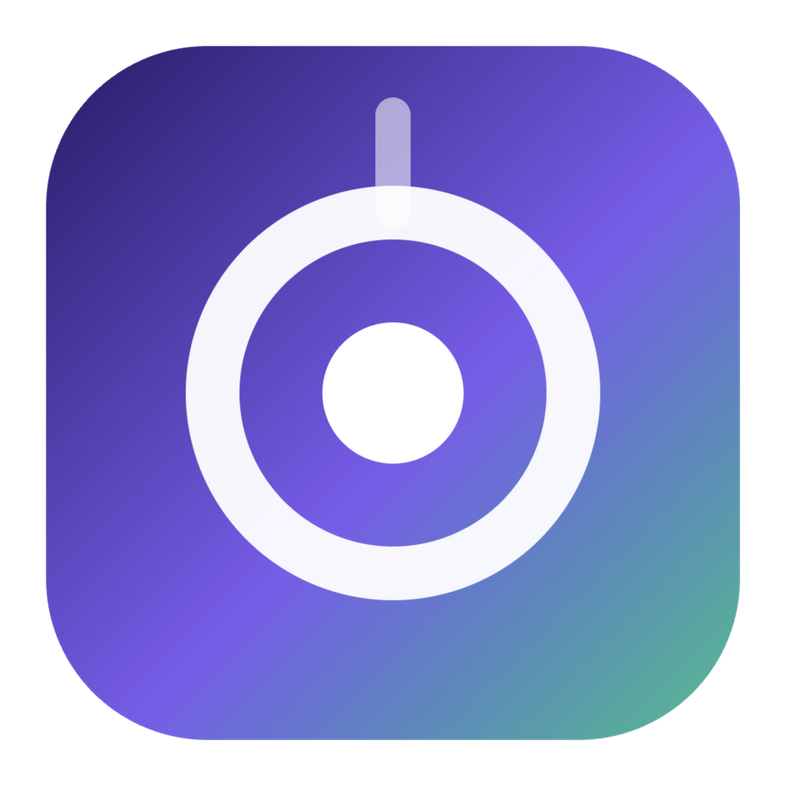
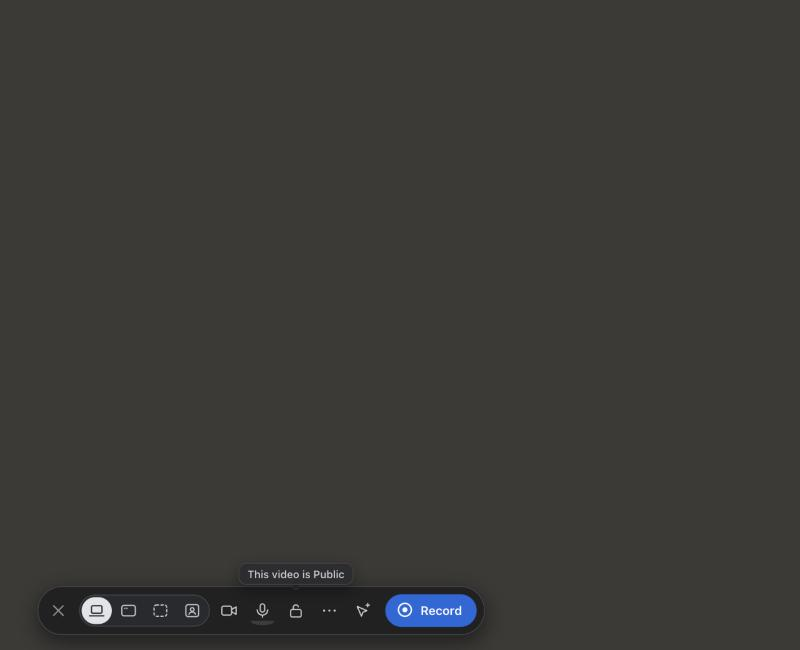
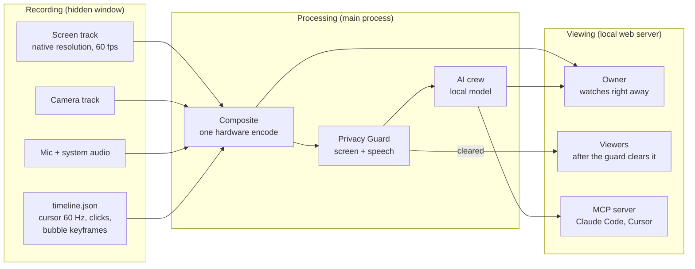
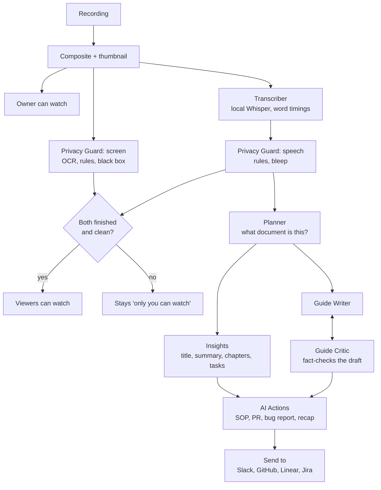

<p align="center"></p>

# Kairos

**Record your screen once. Hand the recording to an AI agent. Keep your secrets off the internet.**



## The problem

You explain a bug, a process or a design to a teammate by recording your screen. Two things go wrong:

1. **The recording leaks.** Your screen has API keys, e-mail addresses, tokens and customer data on it, and you say passwords out loud. Cloud recorders upload all of it, and the "blur" is something you have to remember to apply.
2. **The recording is a dead end for an AI agent.** Claude Code or Cursor cannot watch a video. You retype what you showed. The steps, the clicks and the exact words are lost.

Who feels it: developers filing bug reports, support and QA people, anyone who writes SOPs or onboarding videos from screen recordings, and anyone whose employer does not allow customer data to leave the machine.

## What Kairos does about it

Kairos records your screen and camera, publishes the video to a link you control, and runs a crew of local AI agents on it. Everything runs on your Mac. There is no account and no cloud, unless you choose to turn on **public links** (below): then, and only for a video you click Publish on, a small copy goes to a free storage bucket you own, or to a public repository on your own GitHub account.

1. **The Privacy Guard reads the screen and listens to you.** Before anyone but you can open a recording, it OCRs the picture and covers e-mail addresses, API keys, tokens, card numbers and passwords with a solid black box. It also checks what you *said*: a password or PIN spoken with a phrase like "the password is…" is bleeped in the audio and removed from the transcript and captions. If any check fails, the recording stays "only you can watch". A failure never means "everyone can".
2. **It is built for agents.** Press **Record for agent** and Kairos writes an *Action Plan*: a markdown brief with what you said, the steps you showed, where you clicked and the screenshots. An MCP server hands it to Claude Code, Cursor or any MCP client: *"List my Kairos videos and turn the latest one into a fix."*
3. **A crew of local agents** (Planner, Insights, Guide Writer, Guide Critic, AI Actions) writes the title, summary, chapters and a fact-checked step-by-step guide, then turns the recording into a PR description, bug report or SOP.

The full checklist, with what is tested and what is not, is in [FEATURES.md](FEATURES.md).

## Public links (optional, free, no card)

A normal link only opens on your Mac. For judges, customers or friends, turn on public links: Kairos makes a small copy (1080p, about 37 MB a minute) of the Privacy-Guard-cleared video, uploads it to a **private** Backblaze B2 bucket you own, and a free Cloudflare Worker you deploy serves it at `https://<you>.workers.dev/v/<random>`. It works when your Mac is asleep, supports a password, and the copy is deleted after 30 days. Private and "Ask for email" recordings can never be published, and nothing is ever uploaded without a click. Set-up takes about 20 minutes: [cloud/README.md](cloud/README.md). Check a finished link from anywhere with `node scripts/public-check.js <link>`.

### The quick route: Publish to GitHub

If you do not want Backblaze and Cloudflare, Settings → **Publish to GitHub** takes two minutes: paste a GitHub token (classic, "repo" and "delete_repo" permissions) or tick "Use my GitHub CLI login". In a video's Share dialog choose **GitHub** and Kairos makes a smaller copy (720p, about 16 MB a minute, 3 minutes at most), creates one repository on your account for that video, fills it while it is still **private**, and only then makes it public and turns on GitHub Pages. The link looks like `https://<you>.github.io/kairos-share-<random>/` and shows a plain page with the video.

What you give up compared with the Backblaze route, and the dialog says so before you publish:

- **No password.** Anyone with the link can watch and save the video, and the repository appears on your public GitHub profile (the page asks search engines not to list it). So this route is only offered for "Anyone with the link" videos with downloads on; a video that needs a password here, or has downloads off, is refused.
- **Deleting is not guaranteed.** Kairos deletes the repository after 30 days, on Unpublish, when you delete the video and when privacy is tightened. GitHub may keep copies in caches and anyone who saved or forked the video keeps it. Without the "delete_repo" permission Kairos cannot delete at all: it turns the link off in Kairos and shows you the repository to delete yourself.
- The token is stored on this Mac in Kairos's settings file next to your other settings, not in the Keychain. Anyone who can read your Mac's files can read it.

Private, "Ask for email", unscanned and failed recordings are refused on this route exactly as on the other one. The Privacy Guard does not blur faces on either route.

## Run it (about 5 minutes)

Apple silicon Mac, Node 20 or newer (tested on Node 24). There is no packaged release yet, so you build from source:

```bash
git clone <this repo> && cd spool
npm install
npm run doctor     # checks Node, ffmpeg, Ollama and the models, and prints the fix for anything missing
npm start          # launch Kairos in development mode
# or: npm run build:mac   -> dist/Kairos-darwin-arm64/Kairos.app (signed with a local certificate, not notarised)
```

**Optional, for the AI notes:** install [Ollama](https://ollama.com) and run `ollama pull qwen3:8b`. Any model you have pulled works: pick it in Settings > AI. Without Ollama you still get the recording, the transcript and the Privacy Guard; titles, summaries, guides and AI Actions are skipped, and the launcher tells you so.

### First run

| Permission | Why | Needed for |
|---|---|---|
| Screen Recording | the picture | every screen recording |
| Camera, Microphone | your face and voice | Screen + Cam, Cam only, voice |
| Input Monitoring | click positions for ripples and auto-zoom | optional |

macOS asks the first time you press Record. After you grant Screen Recording, macOS makes you relaunch the app. The first recording also needs the **speech model** (about 150 MB, downloaded once). The launcher shows a warning with a download button if it is missing. Until it is there, the Privacy Guard cannot listen, so a new recording stays "only you can watch". That is deliberate.

## How it works

Recording and publishing are separate. Kairos records the screen and camera as two full-quality tracks, then composites once, on the hardware encoder.



The owner can press play a few seconds after Stop (7.6 s for a 24-second clip on an M2). Viewers wait for the Privacy Guard. Cursor highlight, click ripples and auto-zoom are drawn by the player from `timeline.json`, so they cost nothing while recording.

### The agent crew

Every stage is checkpointed, so a quit in the middle resumes where it stopped. One job runs at a time.



Planner, Insights, Guide Writer, Guide Critic and the AI Actions use the local model through Ollama. They only ever see the transcript and screen text *after* the Privacy Guard has redacted them.

## What it does

| Area | What you get |
|---|---|
| Recording | Screen, Screen + Cam or Cam only; full screen, one window or a custom area; Source (native) quality up to 4K at 60 fps; pause, resume and Live Rewind; pen; speaker notes with a teleprompter and voice dictation; screenshots with annotations |
| Camera | Four bubble shapes, seven filters, six frames; baked into the published video |
| Privacy | Screen OCR with a solid fill, spoken-secret bleeping, fail-closed viewer gate, owner sign-in cookie, password / e-mail / private links, link expiry, lockout after wrong passwords |
| Editing | Timeline with waveform, edit by transcript, remove filler words and silences, insert clips, overlays with `{{variables}}`, CTA button, thumbnail and GIF, one-level undo |
| AI | Title, summary, chapters, tasks, step-by-step guide, captions, translation, SOP / PR description / bug report / issue / follow-up / recap |
| Sharing | Local library with spaces, folders and search; comments, reactions, analytics; link, embed, LAN sharing, optional public links that open on any phone (Backblaze + Cloudflare, or a quick GitHub route with no password); Slack / GitHub / Linear / Jira with a preview before anything is sent |
| For agents | MCP server and Action Plan brief |

The full checklist, with what is tested and what is not, is in [FEATURES.md](FEATURES.md).

### Use it from Claude Code

```bash
claude mcp add kairos -- node /absolute/path/to/spool/mcp/server.js
```

Then: *"List my Kairos videos and turn the latest one into a fix."* The tools are `list_videos`, `search_videos`, `get_transcript`, `get_guide` and `get_action_plan`. See [mcp/README.md](mcp/README.md).

## Models and safety

| Question | Answer |
|---|---|
| Which models run? | Speech: Whisper base, in-process. Screen reading: Apple Vision (Tesseract elsewhere). Notes and agents: any Ollama model, `qwen3:8b` by default. |
| Can I swap the model? | Yes. Settings > AI lists the models you have installed and warns if the chosen one is not pulled. The code path is the same for all of them. |
| What does the language model see? | Only the transcript and screen text *after* the Privacy Guard redacted them. It never sees the video, and it cannot publish anything. |
| What if the model returns junk or hangs? | Every call has a timeout and one retry, and the answer must pass a JSON schema check. A failed step is skipped and reported; it never blocks the recording or opens the link. |
| What can the agents do to my machine? | Nothing. They read text and write text into the library. The MCP server is read-only and only serves videos the Privacy Guard cleared. |
| What if the Privacy Guard itself fails? | The video stays "only you can watch". It fails closed. |

## Privacy model

- **Local first.** Recordings, transcripts and models stay in `~/Library/Application Support/spool`. Nothing is uploaded unless you press Publish on a video's public link (to your own free Backblaze bucket or your own GitHub account, never for a Private recording). The only other network use is downloading the speech model once, and any Send-to action you click.
- **Viewers are gated.** Every request from anyone but you goes through one function. It says "blocked" unless the Privacy Guard has cleared the video. "You" means this machine *and* a per-launch sign-in cookie that only the app hands out, so a tunnel to the port is just another viewer.
- **Secrets are covered, not trusted to a blur.** What the guard finds on screen gets a solid black box, the blurred file replaces the original, and thumbnails and GIFs made earlier are regenerated or deleted. Screenshots go through the same pass.
- **Send-to tokens** stay in local settings and are write-only in the UI. Every send shows the exact request first.

## Limits

These are real. Plan around them.

- **Detection is rules plus an optional model.** The rules cover e-mail, keys, tokens, card numbers, SSNs, phone numbers, passwords and long secrets. Names and addresses need the local model, which only runs when Ollama already has it loaded. The video says "rules-only check" when it did not.
- **Short-lived secrets can be missed.** The screen is sampled twice a second, and an unchanged screen is read at least every 2 seconds. A secret on an otherwise static screen for under 2 seconds can fall between frames.
- **The speech check needs a cue.** It catches "the password is…", "my pin is…", "API key is…", token-like words and runs of 9 or more digits. A bare "hunter2" can get through.
- **E-mail mode is a speed bump,** not authentication. Use a password for anything that matters.
- **Cursor effects live in the player.** They are not burned into a downloaded file.
- **Not notarised, Apple silicon only** for the packaged app. Windows and Linux code paths exist (software encoder, Tesseract) but have only been unit-tested as arguments.
- **No window titles** in the Action Plan: the recorder does not capture them.
- **Sending to Slack, GitHub, Linear and Jira** has been tested against local endpoints and canned responses, not the real services.

## Development

```bash
npm run doctor      # check prerequisites, models and Ollama before the first run
npm test            # unit tests: no windows, no network, about 20 s
npm run test:e2e    # records your real screen: windows appear and Kairos takes over the display for a while
npm run build:mac   # package, trim and sign dist/Kairos-darwin-arm64/Kairos.app
npm run build:mac:dry   # list what would ship and its size, without building
```

Plain CommonJS and Node's built-in test runner; no bundler, no framework. `PLAN.md` has the build history and the measured numbers; `REVIEW.md` is the security review and what was done about it.

## License

MIT, as declared in `package.json`.
