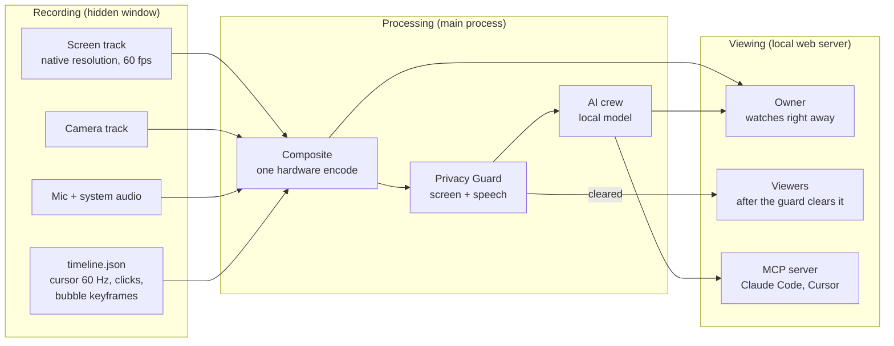
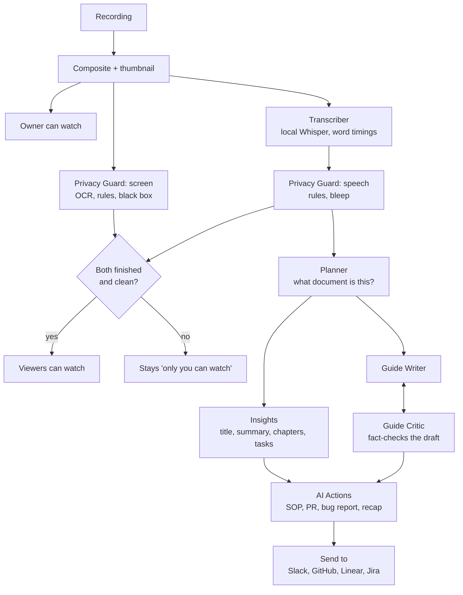

# Spool

**A screen recorder that keeps your secrets off the internet, and turns every recording into something an agent can use.**

Spool records your screen and camera, publishes the video to a link you control, and runs a crew of local AI agents on it: they write the title, summary and chapters, draft a step-by-step guide with screenshots, and turn the recording into a pull-request description, a bug report or an SOP. Everything runs on your Mac. There is no account and no cloud; the speech model, the screen reader and the language model are all local.

Two things set it apart from a cloud recorder:

1. **The Privacy Guard reads the screen and listens to you.** Before anyone but you can open a recording, it OCRs the picture and covers e-mail addresses, API keys, tokens, card numbers and passwords with a solid black box. It also checks what you *said*: a password or PIN spoken with a phrase like "the password is…" is bleeped in the audio and removed from the transcript and captions. If any check fails, the recording stays "only you can watch". A failure never means "everyone can".
2. **It has an MCP server.** Claude Code, Cursor or any MCP client can list your recordings, read a transcript and fetch an "Action Plan": a markdown brief with what you said, the steps you showed, where you clicked and the screenshots.

## Install

**From a release** (Apple silicon Mac): download `Spool-mac-arm64.zip` from the Releases page, unzip, move `Spool.app` to Applications. The app is signed but not notarised, so open it the first time with **right-click → Open**.

**From source** (Node 20 or newer; tested on Node 24):

```bash
npm install
npm start
```

**Optional, for the AI notes:** install [Ollama](https://ollama.com) and run `ollama pull qwen3:8b`. Without it you still get the recording, the transcript and the Privacy Guard; titles, summaries, guides and AI Actions are skipped, and the launcher tells you so.

### First run

| Permission | Why | Needed for |
|---|---|---|
| Screen Recording | the picture | every screen recording |
| Camera, Microphone | your face and voice | Screen + Cam, Cam only, voice |
| Input Monitoring | click positions for ripples and auto-zoom | optional |

macOS asks the first time you press Start. After you grant Screen Recording, macOS makes you relaunch the app.

The first recording needs the **speech model** (about 150 MB, downloaded once). The launcher shows a warning with a download button if it is missing. Until it is there, the Privacy Guard cannot listen, so a new recording stays "only you can watch". That is deliberate.

## How it works

Recording and publishing are separate. Spool records the screen and camera as two full-quality tracks, then composites once, on the hardware encoder.



The owner can press play a few seconds after Stop (7.6 s for a 24-second clip on an M2). Viewers wait for the Privacy Guard. Cursor highlight, click ripples and auto-zoom are drawn by the player from `timeline.json`, so they cost nothing while recording.

### The agent crew

Every stage is checkpointed, so a quit in the middle resumes where it stopped. One job runs at a time.



Planner, Insights, Guide Writer, Guide Critic and the AI Actions use the local model through Ollama. They only ever see the transcript and screen text *after* the Privacy Guard has redacted them.

## What it does

| Area | What you get |
|---|---|
| Recording | Screen, Screen + Cam or Cam only; full screen, one window or a custom area; Source (native) quality up to 4K at 60 fps; pause, resume and Live Rewind; pen; speaker notes with a teleprompter and voice dictation; screenshots with annotations |
| Camera | Four bubble shapes, seven filters, six frames; baked into the published video |
| Privacy | Screen OCR with a solid fill, spoken-secret bleeping, fail-closed viewer gate, owner sign-in cookie, password / e-mail / private links, link expiry, lockout after wrong passwords |
| Editing | Timeline with waveform, edit by transcript, remove filler words and silences, insert clips, overlays with `{{variables}}`, CTA button, thumbnail and GIF, one-level undo |
| AI | Title, summary, chapters, tasks, step-by-step guide, captions, translation, SOP / PR description / bug report / issue / follow-up / recap |
| Sharing | Local library with spaces, folders and search; comments, reactions, analytics; link, embed, LAN sharing; Slack / GitHub / Linear / Jira with a preview before anything is sent |
| For agents | MCP server and Action Plan brief |

The full checklist, with what is tested and what is not, is in [FEATURES.md](FEATURES.md).

### Use it from Claude Code

```bash
claude mcp add spool -- node /absolute/path/to/spool/mcp/server.js
```

Then: *"List my Spool videos and turn the latest one into a fix."* The tools are `list_videos`, `search_videos`, `get_transcript`, `get_guide` and `get_action_plan`. See [mcp/README.md](mcp/README.md).

## Privacy model

- **Local first.** Recordings, transcripts and models stay in `~/Library/Application Support/Spool`. Nothing is uploaded. The only network use is downloading the speech model once, and any Send-to action you click.
- **Viewers are gated.** Every request from anyone but you goes through one function. It says "blocked" unless the Privacy Guard has cleared the video. "You" means this machine *and* a per-launch sign-in cookie that only the app hands out, so a tunnel to the port is just another viewer.
- **Secrets are covered, not trusted to a blur.** What the guard finds on screen gets a solid black box, the blurred file replaces the original, and thumbnails and GIFs made earlier are regenerated or deleted. Screenshots go through the same pass.
- **Send-to tokens** stay in local settings and are write-only in the UI. Every send shows the exact request first.

## Limits

These are real. Plan around them.

- **Detection is rules plus an optional model.** The rules cover e-mail, keys, tokens, card numbers, SSNs, phone numbers, passwords and long secrets. Names and addresses need the local model, which only runs when Ollama already has it loaded. The video says "rules-only check" when it did not.
- **Short-lived secrets can be missed.** The screen is sampled twice a second, and an unchanged screen is read at least every 2 seconds. A secret on an otherwise static screen for under 2 seconds can fall between frames.
- **The speech check needs a cue.** It catches "the password is…", "my pin is…", "API key is…", token-like words and runs of 9 or more digits. A bare "hunter2" can get through.
- **E-mail mode is a speed bump,** not authentication. Use a password for anything that matters.
- **Cursor effects live in the player.** They are not burned into a downloaded file.
- **Not notarised, Apple silicon only** for the packaged app. Windows and Linux code paths exist (software encoder, Tesseract) but have only been unit-tested as arguments.
- **No window titles** in the Action Plan: the recorder does not capture them.
- **Sending to Slack, GitHub, Linear and Jira** has been tested against local endpoints and canned responses, not the real services.

## Development

```bash
npm test            # unit tests: no windows, no network, about 20 s
npm run test:e2e    # records your real screen: windows appear and Spool takes over the display for a while
npm run build:mac   # package, trim and sign dist/Spool-darwin-arm64/Spool.app
npm run build:mac:dry   # list what would ship and its size, without building
```

Plain CommonJS and Node's built-in test runner; no bundler, no framework. `PLAN.md` has the build history and the measured numbers; `REVIEW.md` is the security review and what was done about it.

## License

MIT, as declared in `package.json`.
